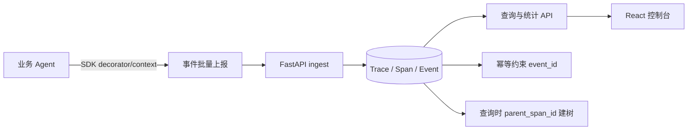

# AgentTrace 架构与技术复盘

## 模块边界

- `sdk/agenttrace_sdk/client.py`：生成 Trace/Span ID、上下文传播、异常安全上报、输入输出截断与脱敏。
- `backend/app/service.py`：事件幂等、Trace/Span 归属校验、状态优先级和时间归一化，是一致性的核心。
- `backend/app/models.py`：持久化模型。`SpanEvent` 只记录已接收事件，`Span` 记录当前聚合快照。
- `backend/app/main.py`：REST API 和 OpenAPI 文档入口。
- `frontend/src/main.tsx`：执行列表、详情时间线、Span 检查器和统计页。

## 一次请求的真实链路

以演示 Agent 的工具超时为例：业务代码进入 `client.start("Call knowledge tool")`，SDK 先发送 RUNNING 事件；工具抛出 `RuntimeError` 后上下文管理器发送 FAILED 事件并重新抛出原异常。后端用 `event_id` 去重，保留错误类型和摘要；详情页按 `started_at` 展示步骤，点击失败步骤后右侧显示错误原因和输入输出摘要。

## 面试讲解重点

1. 为什么事件和 Span 分开：事件是不可重复接收的事实，Span 是方便查询的最终快照。
2. 为什么不在写入时强行挂树：子 Span 可能先到，写入时只保留 parent_span_id，读取时再组装。
3. 为什么 SDK 不抛上报异常：可观测性不能改变业务行为；SDK 只在 debug 日志记录网络失败。
4. 为什么终态有优先级：延迟到达的 RUNNING 不能覆盖已经记录的 FAILED/SUCCESS。

## 已验证与待改进

已用临时 SQLite 验证正常采集、失败步骤、重复提交、过滤分页、Trace/Span 归属和敏感字段脱敏；前端已通过 TypeScript 和 Vite production build。待改进包括真正的 Alembic 历史迁移、鉴权、多租户、WebSocket 实时刷新和大规模 DAG 画布。
